# graphlay

Deterministic graph layout in pure Rust. The main engine is layered (Sugiyama-style): cycle
breaking, weight-aware layering, crossing minimisation, network-simplex or Brandes-Kopf
coordinates, and orthogonal or diagonal edge routing. There is also a tidy-tree layout and an SVG
renderer. The npm package (wasm) and the Python package wrap the same engine and give the same
drawings.

It works on any directed graph, but I built it for process models.
[rust4pm](https://github.com/aarkue/rust4pm) and [propel](https://github.com/aarkue/propel) use it
to draw Petri nets and directly-follows graphs.

Version 0.2. Until 1.0 the API can change between minor versions.

| | | |
|---|---|---|
| [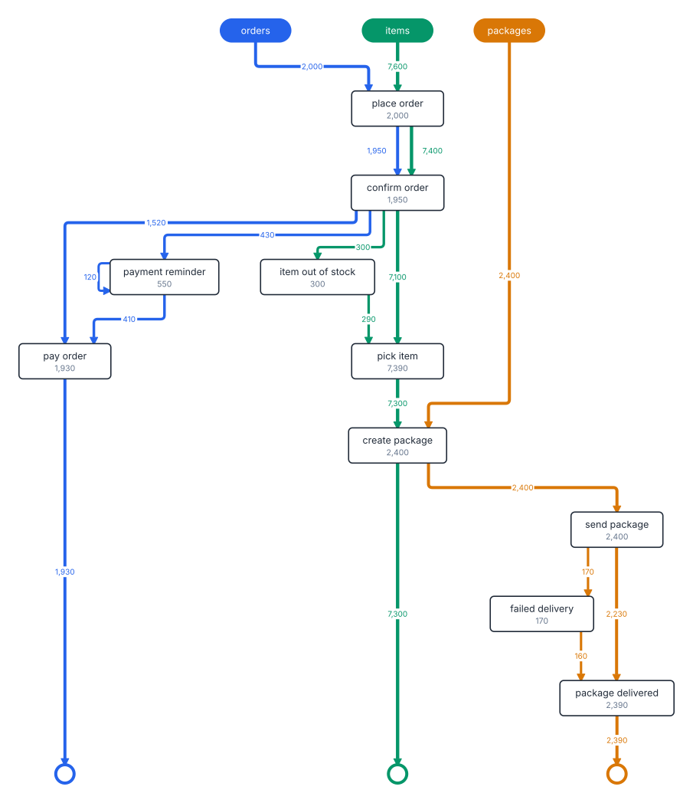](docs/gallery.md#process-models) | [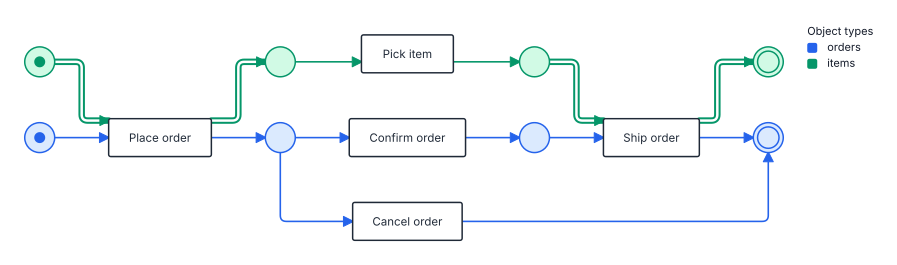](docs/gallery.md#process-models) | [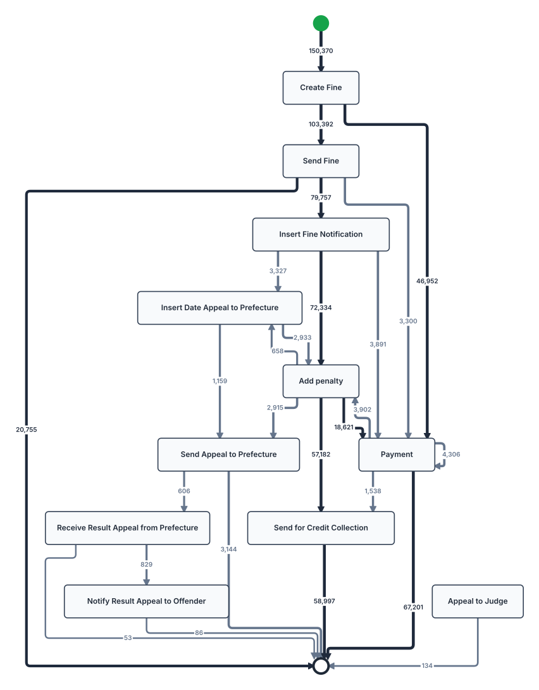](docs/gallery.md#process-models) |
| [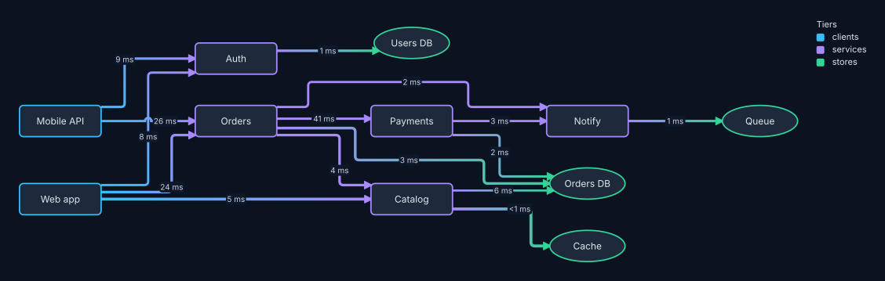](docs/gallery.md#drawing-styles) | [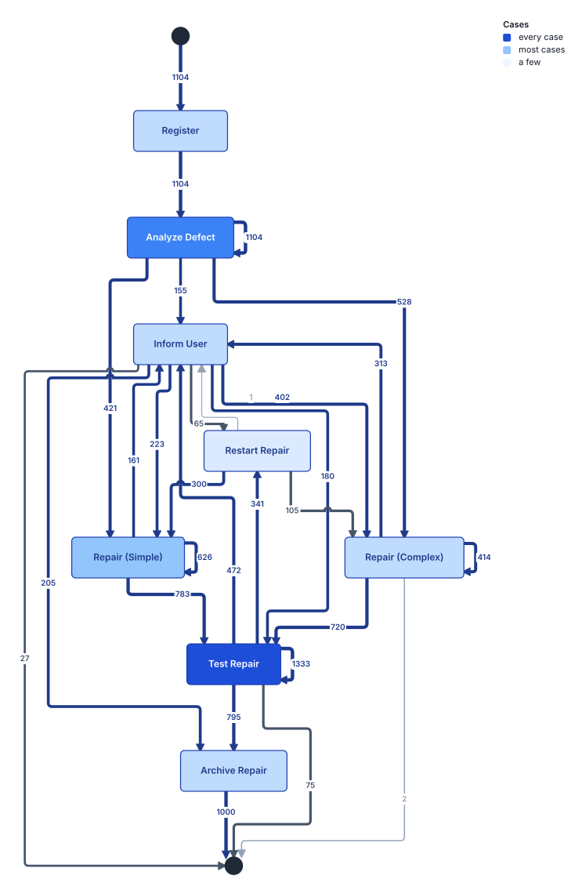](docs/gallery.md#drawing-styles) | [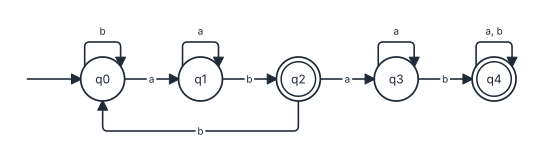](docs/gallery.md#drawing-styles) |
| [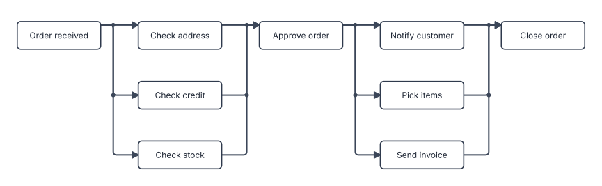](docs/gallery.md#merged-edges) | [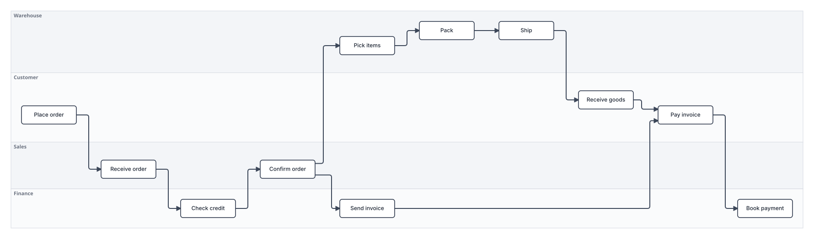](docs/gallery.md#swimlanes) | [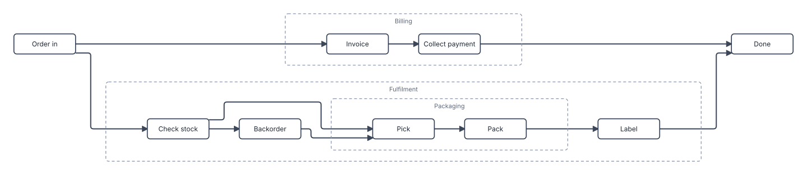](docs/gallery.md#nested-subprocesses) |
| [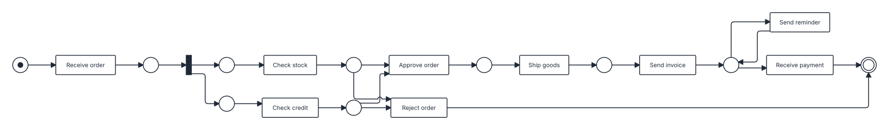](docs/gallery.md#process-models) | [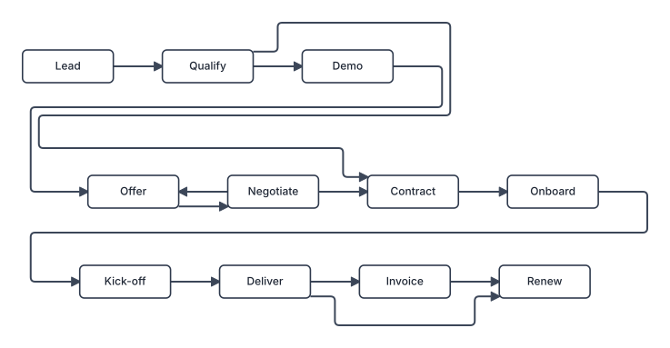](docs/gallery.md#wrapping-into-rows) | [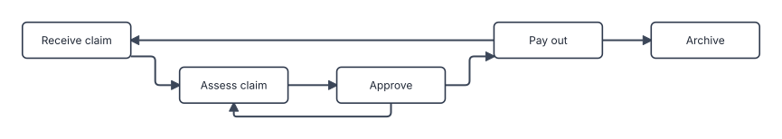](docs/gallery.md#port-hints) |

The [gallery](docs/gallery.md) shows each drawing with the code that made it.

## Packages

| package | install | docs |
|---|---|---|
| Rust crate | `cargo add graphlay` | `cargo doc --open` |
| npm (wasm) | `npm install graphlay` | [`bindings/wasm/js/README.md`](bindings/wasm/js/README.md) |
| Python | `pip install graphlay` | [`bindings/python/README.md`](bindings/python/README.md) |
| command line | `cargo install graphlay-cli` | [`cli/README.md`](cli/README.md) |

## Usage

Build a `Graph`, pass it to `layout` and draw the result:

```rust
use graphlay::{layout, GraphBuilder, LayoutOptions, Node, Size};

let mut b = GraphBuilder::new();
let a = b.add_node(Node { size: Size::new(120.0, 52.0), ..Node::default() });
let c = b.add_node(Node { size: Size::new(120.0, 52.0), ..Node::default() });
b.connect(a, c);

let drawing = layout(&b.build(), &LayoutOptions::layered_default()).expect("a valid graph");
for placement in &drawing.nodes {
    println!("({:.0}, {:.0}) in layer {:?}", placement.center.x, placement.center.y, placement.rank);
}
for route in &drawing.edges {
    println!("{:?}: {} points", route.kind, route.points.len());
}
```

| what | where |
|---|---|
| input | `graphlay::graph`: `Graph`, `Node`, `Edge`, `GraphBuilder` |
| options | `graphlay::options`: `LayoutOptions` and its presets |
| output | `graphlay::layout`: `Layout`, `Placement`, `EdgeRoute`, `PortInfo`, `RouteKind` |
| entry points | `graphlay::layout`, `graphlay::reroute`, `graphlay::tree::layout` |
| SVG | `graphlay::svg`: `sketch` for a plain drawing, `render` for a `Scene` you build |
| JSON | `graphlay::json`: `{ "graph": ..., "preset": ..., "options": ... }` |
| metrics | `graphlay::metrics::measure` |

## Documentation

- [`docs/guide.md`](docs/guide.md): which options to set for which goal.
- [`docs/gallery.md`](docs/gallery.md): a picture of each feature, with its code.
- [`docs/svg.md`](docs/svg.md): the SVG renderer and its scene model.
- [`docs/architecture.md`](docs/architecture.md): modules and layout phases.
- [`docs/quality.md`](docs/quality.md): the quality metrics and the score.
- [`docs/benchmarks.md`](docs/benchmarks.md): graphlay, dagre and ELK on the same corpus.
- [`docs/literature.md`](docs/literature.md): the papers behind the phases and metrics.

## Features

### Ports

Each edge end starts on the border that faces where the edge goes. `Routing::port_sides` (per
drawing) and `Node::port_sides` (per node) decide when the router may move an end to a border
across the flow, e.g., the top of a node in a left-to-right drawing:

- `FacingOnly` never does.
- `FacingPreferred` does when staying would cost a crossing or overfill the border.
- `Any` does whenever that saves a bend at no crossing cost.
- `LongEdgesAny` acts like `Any` for edges over several layers and like `FacingPreferred` for the
  rest. On process maps it halves the extra corners for a few percent more crossings.

`Routing::centre_ports` packs the ends on a border around its middle. The default `Round` does
this for ellipses, so an arc meets a Petri-net place head-on. `All` does it for every shape.

`Edge::source_port` and `Edge::target_port` pin an end with `PortHint::Side(side)` or
`PortHint::Offset { side, t }`, where `t` runs from `-1` to `1` along the border. Sides are in
screen terms. A hint beats `port_sides` and every later pass. Hinted edges are not bundled or
merged.

`Routing::merge_edges` (`Forks`, `Joins` or `Both`) draws the edges leaving or entering a node on
one shared trunk, where that adds no crossing and no bend. `Layout::junctions` lists the branch
points.

### Compounds

A node with `Node::parent` set is drawn inside that parent. Compounds nest to any depth. The
layout runs bottom-up: it lays out each compound's children, sizes the compound to fit them plus
`Spacing::compound_padding` and `Spacing::compound_header`, and treats it as one node on the level
above. An edge that crosses a compound border comes back as one polyline. `reroute()` and the tree
layout take flat graphs only.

### Lanes

`Node::group` puts nodes into lanes. `OrderOptions::group_lanes = Soft` (default) bands the groups
as far as `group_lane_budget_percent` and `group_lane_area_percent` allow. At their default of zero
it only takes bandings that cost no crossings. `Strict` draws swimlanes, one strip per group, and
`Layout::lanes` returns the strips. `Node::lane_key` orders the nodes inside a lane.

### Cycles

One edge of every cycle has to point backwards. `CycleStrategy::MinimumReversal` (default)
reverses the least total edge weight, which gives the fewest crossings on dense graphs.
`CycleStrategy::FollowFlow` sends each cycle's return edge back to where the flow entered it, so
the drawing reads in the order things happen. If you know which edges are loops, set
`Edge::reverse_for_ranking` on them.

### Fork/join blocks

`CoordOptions::branch_style` picks how XOR and AND blocks look. `StraightMain` runs the heaviest
branch straight from fork to join and pushes the others aside as skips. `Symmetric` puts two
branches at equal distance either side of a straight fork-join line. `Free` keeps what placement
produced. The process presets use `StraightMain`. The pass only moves nodes across the flow and
never reorders a layer.

### Rank constraints

`Node::rank = RankConstraint::Fixed(k)` puts nodes with the same `k` in one layer and nodes with
a larger `k` further along. `First` and `Last` pin a node to the first or last layer. An edge
inside one fixed layer is an error.

### Row wrapping

`LayoutOptions::wrap.viewport_aspect` wraps a long drawing into rows for a viewport of that
width/height ratio, when that makes it come out larger on screen. Edges that cross a cut take one
U-turn between the rows. It is off by default.

### Stable output

Give every node a `Node::key` and the drawing depends only on the graph, not on the order of nodes
and edges.

To keep nodes in place across filtered views, lay out the full graph once, set each node's
`position` to its place there, and lay out the view with `seed_mode = SeedMode::Structure`. Nodes
keep their layer and order. After a user drags a node, `reroute` keeps every node where it is and
routes the edges again.

### Trees

`tree::layout` draws a tidy tree. Edges are org-chart elbows by default
(`TreeOptions::edge_style`), which never pass through a node.

### Self-loops

A self-loop comes back as a `RouteKind::SelfLoop` bump on one border of its node. The layout
reserves room for it (`LayoutOptions::self_loops`).

## Feature flags

| feature | default | contents |
|---|---|---|
| `serde` | yes | the `json` module, with errors that name the bad field |
| `svg` | yes | the SVG renderer, `graphlay::svg` |
| `parallel` | yes | crossing minimisation on several threads, with the same result as on one. Does nothing on wasm |
| `schemars` | no | `JsonSchema` derives, for binding generators |
| `fixtures` | no | the fixture loader, the synthetic generator, the `eval` example and the gallery test |

## Measuring quality

`graphlay::metrics::measure` counts crossings, edges through nodes, bends, area, edge length,
clearances and label size after fitting to a screen. [`docs/quality.md`](docs/quality.md) defines
each metric and the score.

The `eval` example lays out every fixture under `fixtures/` (format:
[`fixtures/FORMAT.md`](fixtures/FORMAT.md)) and prints the metrics. To check a change:

```sh
cargo run --release --features fixtures --example eval -- --save-baseline /tmp/before.json
# change the engine
cargo run --release --features fixtures --example eval -- --baseline /tmp/before.json
```

`--help` lists the other flags. The exit code is 1 if any fixture fails to lay out.

## Tests

`tests/golden.rs` fingerprints the layout of every fixture, `tests/gallery.rs` redraws
`docs/gallery/`, and `tests/conformance.rs` pins the corpus under `tests/conformance/` that the npm
and Python packages must reproduce. When a change is meant to move drawings, this rewrites all
three. Review the diff before committing:

```sh
GRAPHLAY_BLESS=1 cargo test --release --all-features --test golden --test gallery --test conformance
```
