<!-- Generated by tests/gallery.rs. Do not edit by hand: change the examples in tests/gallery/ and regenerate with
     GRAPHLAY_BLESS=1 cargo test --release -p graphlay --all-features --test gallery -->

# Gallery

Every drawing here is laid out by graphlay and drawn by its SVG renderer, from the code shown under it. `tests/gallery.rs` redraws them and fails when a drawing changes. `Panel` in the code is the gallery's own wrapper for a caption, the graph and its layout.

## Contents

- [A first drawing](#a-first-drawing)
- [Process models](#process-models)
- [Presets, directions and routing styles](#presets-directions-and-routing-styles)
- [Merged edges](#merged-edges)
- [Port hints](#port-hints)
- [Swimlanes](#swimlanes)
- [Nested subprocesses](#nested-subprocesses)
- [Wrapping into rows](#wrapping-into-rows)
- [A tidy tree](#a-tidy-tree)
- [Drawing styles](#drawing-styles)

## A first drawing

Nodes are boxes with a size and a key (a stable name, used here as the label). Edges connect them. `layout` assigns every node a centre and every edge a polyline, border to border.

**default options**

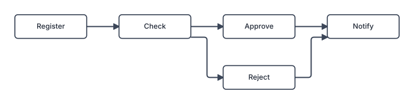

<details><summary>Code (<code>tests/gallery/quick_start.rs</code>)</summary>

```rust
use graphlay::{layout, GraphBuilder, LayoutOptions, Node, Size};

use super::Panel;

pub fn panels() -> Vec<Panel> {
    let mut b = GraphBuilder::new();
    let mut task = |name: &str| {
        b.add_node(Node {
            size: Size::new(120.0, 40.0),
            key: Some(name.to_string()),
            ..Node::default()
        })
    };
    let (register, check, approve, reject, notify) = (
        task("Register"),
        task("Check"),
        task("Approve"),
        task("Reject"),
        task("Notify"),
    );
    for (s, t) in [
        (register, check),
        (check, approve),
        (check, reject),
        (approve, notify),
        (reject, notify),
    ] {
        b.connect(s, t);
    }
    let graph = b.build();
    let options = LayoutOptions::default();
    let drawing = layout(&graph, &options).expect("lays out");
    vec![Panel::new("default options", graph, &options, drawing)]
}
```

</details>

## Process models

Process models are the main use case. The first three are written by hand: a Petri net of an order process, an object-centric Petri net in which orders and their items move together, and an object-centric directly-follows graph of orders, items and packages. Then a directly-follows graph and a Petri net discovered from a real event log, the road traffic fines of an Italian police force. Each is laid out with one preset, sketched with `sketch_scene`, and restyled by editing the `Scene`.

**a Petri net: order to cash**


**an object-centric Petri net**


**an object-centric directly-follows graph**


**a directly-follows graph of road traffic fines**


**the Petri net discovered from the same log**

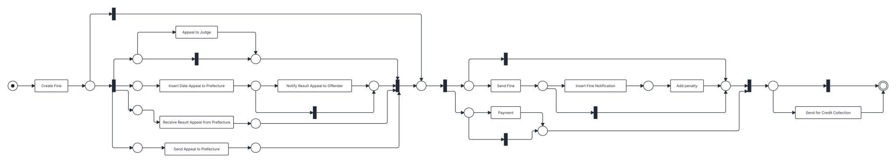

<details><summary>Code (<code>tests/gallery/process_models.rs</code>)</summary>

```rust
use std::path::Path;

use graphlay::svg::{
    self, sketch_scene, BuiltinMarker, Decoration, EdgeLabel, GlyphRow, LegendItem, LineCap,
    MarkerRef, NodeContent, Overlay, Paint, Palette, Point, Ring, SketchOptions, Stroke, Swatch,
    TextRun,
};
use graphlay::{
    fixture, layout, Edge, GraphBuilder, GroupId, Layout, LayoutOptions, Node, NodeId,
    RankConstraint, Shape, Size,
};

use super::Panel;

const INK: &str = "#1f2937";
const MUTED: &str = "#64748b";
/// Object types: name, colour, tint.
const TYPES: [(&str, &str, &str); 3] = [
    ("orders", "#2563eb", "#dbeafe"),
    ("items", "#059669", "#d1fae5"),
    ("packages", "#d97706", "#fef3c7"),
];

/// A count with thousands separators, as a process-mining tool prints it.
fn count(n: u64) -> String {
    let digits = n.to_string();
    let mut out = String::new();
    for (i, c) in digits.chars().enumerate() {
        if i > 0 && (digits.len() - i).is_multiple_of(3) {
            out.push(',');
        }
        out.push(c);
    }
    out
}

/// The room an edge label of `text` needs.
fn label_size(text: &str) -> Size {
    Size::new(6.5 * text.len() as f64 + 10.0, 14.0)
}

/// `text` on a chip, at the spot the layout reserved for edge `i`'s label.
fn chip(drawing: &Layout, i: usize, text: String, colour: &str) -> EdgeLabel {
    let text = TextRun::new(text).size(10.0).weight(600.0).color(colour);
    EdgeLabel::new(text, drawing.edges[i].label_anchor).chip()
}

#[derive(Clone, Copy, PartialEq)]
enum Kind {
    Place,
    Transition,
    Silent,
}

/// A Petri net under construction. Places are circles, transitions boxes sized to their label,
/// silent transitions narrow bars. Places and arcs may carry an object type, and an arc may be
/// variable, consuming or producing any number of objects at once.
#[derive(Default)]
struct Net {
    b: GraphBuilder,
    kinds: Vec<Kind>,
    labels: Vec<String>,
    types: Vec<Option<usize>>,
    arcs: Vec<(Option<usize>, bool)>,
}

impl Net {
    fn add(&mut self, kind: Kind, label: &str, size: Size, ty: Option<usize>) -> NodeId {
        self.kinds.push(kind);
        self.labels.push(label.to_string());
        self.types.push(ty);
        let shape = if kind == Kind::Place {
            Shape::Ellipse
        } else {
            Shape::Box
        };
        self.b.add_node(Node {
            size,
            shape,
            ..Node::default()
        })
    }
    fn place(&mut self, ty: Option<usize>) -> NodeId {
        self.add(Kind::Place, "", Size::new(30.0, 30.0), ty)
    }
    fn transition(&mut self, label: &str) -> NodeId {
        let width = (6.8 * label.len() as f64 + 28.0).clamp(92.0, 230.0);
        self.add(Kind::Transition, label, Size::new(width, 38.0), None)
    }
    fn silent(&mut self) -> NodeId {
        self.add(Kind::Silent, "", Size::new(10.0, 38.0), None)
    }
    fn arc(&mut self, from: NodeId, to: NodeId) {
        self.typed_arc(from, to, None, false);
    }
    fn typed_arc(&mut self, from: NodeId, to: NodeId, ty: Option<usize>, variable: bool) {
        self.b.connect(from, to);
        self.arcs.push((ty, variable));
    }

    /// Lays the net out left to right and draws it: tokens in the initial places, a double ring
    /// on the final ones, object types as colours and variable arcs as double lines.
    fn draw(self, caption: &str) -> Panel {
        let graph = self.b.build();
        let options = LayoutOptions::layered_default();
        let drawing = layout(&graph, &options).expect("lays out");
        let has_in = |i: usize| graph.edges.iter().any(|e| e.target.index() == i);
        let has_out = |i: usize| graph.edges.iter().any(|e| e.source.index() == i);
        let colour = |ty: Option<usize>| ty.map_or(INK, |t| TYPES[t].1);

        let sketch = SketchOptions {
            labels: self.labels.clone(),
            ..SketchOptions::default()
        };
        let mut scene = sketch_scene(&graph, &drawing, &sketch);
        for (i, node) in scene.nodes.iter_mut().enumerate() {
            match self.kinds[i] {
                Kind::Place => {
                    let c = colour(self.types[i]);
                    node.shape = svg::Shape::Circle;
                    node.fill = Some(self.types[i].map_or("#ffffff", |t| TYPES[t].2).to_string());
                    node.stroke = Some(Stroke::new(c, 1.5));
                    if !has_in(i) {
                        node.content
                            .push(NodeContent::Glyphs(GlyphRow::dots(1, 5.5, c)));
                    }
                    if !has_out(i) {
                        let ring = Ring {
                            color: c.to_string(),
                            width: 1.5,
                            inset: 3.5,
                        };
                        node.content.push(NodeContent::Rings { rings: vec![ring] });
                    }
                }
                Kind::Transition => {
                    node.shape = svg::Shape::Rect { corner_radius: 2.0 };
                    node.stroke = Some(Stroke::new(INK, 1.5));
                    if let Some(text) = node.label_mut() {
                        text.color = Some(INK.to_string());
                        text.size = Some(11.5);
                    }
                }
                Kind::Silent => {
                    node.shape = svg::Shape::Rect { corner_radius: 0.0 };
                    node.fill = Some(INK.to_string());
                    node.stroke = Some(Stroke::new(INK, 1.6));
                }
            }
        }
        for (edge, &(ty, variable)) in scene.edges.iter_mut().zip(&self.arcs) {
            let c = colour(ty);
            edge.corner_radius = 6.0;
            if variable {
                // A double line: a wide band in the type's colour under a white core.
                let band = Stroke {
                    linecap: LineCap::Round,
                    ..Stroke::new(c, 6.5)
                };
                edge.decorations.push(Decoration::band(edge, band));
                edge.stroke = Stroke::new("#ffffff", 2.5);
                edge.marker_end = MarkerRef::builtin(BuiltinMarker::Arrow).colored(c);
            } else {
                edge.stroke = Stroke::new(c, 1.6);
            }
        }
        if self.types.iter().any(Option::is_some) {
            let items = TYPES
                .iter()
                .enumerate()
                .filter(|(t, _)| self.types.contains(&Some(*t)))
                .map(|(_, (name, c, _))| LegendItem::new(Swatch::color(*c), *name));
            let origin = Point::new(drawing.bounds.max.x + 24.0, drawing.bounds.min.y);
            let legend = svg::Panel::legend(origin, "Object types", items);
            scene.overlays.push(Overlay::panel(legend));
        }
        Panel::new(caption, graph, &options, drawing).scene(scene, Palette::default())
    }
}

/// An order process: receive the order, check stock and credit in parallel, then ship or
/// reject, and send reminders until the payment arrives.
fn order_to_cash() -> Panel {
    let mut n = Net::default();
    let start = n.place(None);
    let receive = n.transition("Receive order");
    let p1 = n.place(None);
    let split = n.silent();
    let (stock_in, credit_in) = (n.place(None), n.place(None));
    let check_stock = n.transition("Check stock");
    let check_credit = n.transition("Check credit");
    let (stock_ok, credit_ok) = (n.place(None), n.place(None));
    let approve = n.transition("Approve order");
    let reject = n.transition("Reject order");
    let decided = n.place(None);
    let ship = n.transition("Ship goods");
    let shipped = n.place(None);
    let invoice = n.transition("Send invoice");
    let open = n.place(None);
    let remind = n.transition("Send reminder");
    let pay = n.transition("Receive payment");
    let done = n.place(None);
    for (a, b) in [
        (start, receive),
        (receive, p1),
        (p1, split),
        (split, stock_in),
        (split, credit_in),
        (stock_in, check_stock),
        (credit_in, check_credit),
        (check_stock, stock_ok),
        (check_credit, credit_ok),
        (stock_ok, approve),
        (credit_ok, approve),
        (stock_ok, reject),
        (credit_ok, reject),
        (approve, decided),
        (decided, ship),
        (ship, shipped),
        (shipped, invoice),
        (invoice, open),
        (open, remind),
        (remind, open),
        (open, pay),
        (pay, done),
        (reject, done),
    ] {
        n.arc(a, b);
    }
    n.draw("a Petri net: order to cash")
}

/// An object-centric Petri net: an order and its items are placed together, the items are
/// picked one by one, and the order ships with all of them.
fn object_centric_net() -> Panel {
    let (o, i) = (Some(0), Some(1));
    let mut n = Net::default();
    let (o_start, i_start) = (n.place(o), n.place(i));
    let place = n.transition("Place order");
    let (o_placed, i_placed) = (n.place(o), n.place(i));
    let confirm = n.transition("Confirm order");
    let cancel = n.transition("Cancel order");
    let o_confirmed = n.place(o);
    let pick = n.transition("Pick item");
    let i_picked = n.place(i);
    let ship = n.transition("Ship order");
    let (o_end, i_end) = (n.place(o), n.place(i));
    n.typed_arc(o_start, place, o, false);
    n.typed_arc(i_start, place, i, true);
    n.typed_arc(place, o_placed, o, false);
    n.typed_arc(place, i_placed, i, true);
    n.typed_arc(o_placed, confirm, o, false);
    n.typed_arc(confirm, o_confirmed, o, false);
    n.typed_arc(o_placed, cancel, o, false);
    n.typed_arc(cancel, o_end, o, false);
    n.typed_arc(i_placed, pick, i, false);
    n.typed_arc(pick, i_picked, i, false);
    n.typed_arc(o_confirmed, ship, o, false);
    n.typed_arc(i_picked, ship, i, true);
    n.typed_arc(ship, o_end, o, false);
    n.typed_arc(ship, i_end, i, true);
    n.draw("an object-centric Petri net")
}

/// An object-centric directly-follows graph of an online shop: what happens to orders, to their
/// items and to the packages they ship in, each object type in its own colour, with how often
/// each step occurred.
fn object_centric_dfg() -> Panel {
    const ACTIVITIES: [(&str, usize, u64); 10] = [
        ("place order", 0, 2000),
        ("confirm order", 0, 1950),
        ("payment reminder", 0, 550),
        ("pay order", 0, 1930),
        ("item out of stock", 1, 300),
        ("pick item", 1, 7390),
        ("create package", 2, 2400),
        ("send package", 2, 2400),
        ("failed delivery", 2, 170),
        ("package delivered", 2, 2390),
    ];
    let mut b = GraphBuilder::new();
    let activity: Vec<NodeId> = ACTIVITIES
        .iter()
        .map(|(name, ty, _)| {
            b.add_node(Node {
                size: Size::new((7.0 * name.len() as f64 + 30.0).max(120.0), 46.0),
                group: Some(GroupId(*ty as u32)),
                ..Node::default()
            })
        })
        .collect();
    let mut ends = |rank: RankConstraint, size: Size| -> Vec<NodeId> {
        (0..TYPES.len())
            .map(|ty| {
                b.add_node(Node {
                    size,
                    rank,
                    group: Some(GroupId(ty as u32)),
                    ..Node::default()
                })
            })
            .collect()
    };
    let start = ends(RankConstraint::First, Size::new(92.0, 30.0));
    let end = ends(RankConstraint::Last, Size::new(24.0, 24.0));
    let a = |name: &str| activity[ACTIVITIES.iter().position(|x| x.0 == name).expect("known")];
    let flows: Vec<(NodeId, NodeId, usize, u64)> = vec![
        (start[0], a("place order"), 0, 2000),
        (a("place order"), a("confirm order"), 0, 1950),
        (a("confirm order"), a("pay order"), 0, 1520),
        (a("confirm order"), a("payment reminder"), 0, 430),
        (a("payment reminder"), a("payment reminder"), 0, 120),
        (a("payment reminder"), a("pay order"), 0, 410),
        (a("pay order"), end[0], 0, 1930),
        (start[1], a("place order"), 1, 7600),
        (a("place order"), a("confirm order"), 1, 7400),
        (a("confirm order"), a("pick item"), 1, 7100),
        (a("confirm order"), a("item out of stock"), 1, 300),
        (a("item out of stock"), a("pick item"), 1, 290),
        (a("pick item"), a("create package"), 1, 7300),
        (a("create package"), end[1], 1, 7300),
        (start[2], a("create package"), 2, 2400),
        (a("create package"), a("send package"), 2, 2400),
        (a("send package"), a("package delivered"), 2, 2230),
        (a("send package"), a("failed delivery"), 2, 170),
        (a("failed delivery"), a("package delivered"), 2, 160),
        (a("package delivered"), end[2], 2, 2390),
    ];
    for &(s, t, ty, n) in &flows {
        let mut e = Edge::new(s, t);
        e.group = Some(GroupId(ty as u32));
        e.weight = 1.0 + (n as f64).ln();
        e.thickness = 1.4 + 3.0 * (n as f64).ln() / 7600f64.ln();
        e.label_size = Some(label_size(&count(n)));
        b.add_edge(e);
    }
    let graph = b.build();
    let options = LayoutOptions::process_map();
    let drawing = layout(&graph, &options).expect("lays out");

    let mut scene = sketch_scene(&graph, &drawing, &SketchOptions::default());
    for (i, node) in scene.nodes.iter_mut().enumerate() {
        if let Some(&(name, _, n)) = ACTIVITIES.get(i) {
            node.stroke = Some(Stroke::new(INK, 1.6));
            node.content = vec![
                NodeContent::Text(TextRun::new(name).at(0.0, -7.0).weight(600.0).color(INK)),
                NodeContent::Text(
                    TextRun::new(count(n))
                        .at(0.0, 9.0)
                        .size(10.5)
                        .weight(500.0)
                        .color(MUTED),
                ),
            ];
        } else if let Some(&(name, c, _)) = TYPES.get(i - ACTIVITIES.len()) {
            node.shape = svg::Shape::Rect {
                corner_radius: 15.0,
            };
            node.fill = Some(c.to_string());
            node.stroke = Some(Stroke::new(c, 1.6));
            node.content = vec![NodeContent::Text(
                TextRun::new(name).weight(600.0).color("#ffffff"),
            )];
        } else {
            let c = TYPES[i - ACTIVITIES.len() - TYPES.len()].1;
            node.shape = svg::Shape::Circle;
            node.stroke = Some(Stroke::new(c, 4.0));
        }
    }
    for (i, edge) in scene.edges.iter_mut().enumerate() {
        let (_, _, ty, n) = flows[i];
        let c = TYPES[ty].1;
        edge.stroke.paint = Paint::color(c);
        edge.labels.push(chip(&drawing, i, count(n), c));
    }
    Panel::new(
        "an object-centric directly-follows graph",
        graph,
        &options,
        drawing,
    )
    .scene(scene, Palette::default())
}

/// The road traffic fines log as a directly-follows graph, its most frequent quarter of the
/// steps: edge width and the count on each edge say how many fines took that step.
fn fines_dfg() -> Panel {
    let path = Path::new(env!("CARGO_MANIFEST_DIR")).join("fixtures/dfg/dfg-rtfm-top25pct.json");
    let f = fixture::load_file(&path).expect("the fixture loads");
    let (mut graph, options) = f.to_graph();
    let counts: Vec<u64> = f
        .edges
        .iter()
        .map(|e| e.label.as_deref().and_then(|t| t.parse().ok()).unwrap_or(0))
        .collect();
    for (i, n) in graph.nodes.iter_mut().enumerate() {
        if f.nodes[i].label.is_empty() {
            n.size = Size::new(24.0, 24.0);
        }
    }
    let most = counts.iter().copied().max().unwrap_or(1).max(2) as f64;
    for (e, &n) in graph.edges.iter_mut().zip(&counts) {
        e.thickness = 1.2 + 3.6 * (n.max(1) as f64).ln() / most.ln();
        e.label_size = Some(label_size(&count(n)));
    }
    let drawing = layout(&graph, &options).expect("lays out");

    let labels = f.nodes.iter().map(|n| n.label.clone()).collect();
    let sketch = SketchOptions {
        labels,
        ..SketchOptions::default()
    };
    let mut scene = sketch_scene(&graph, &drawing, &sketch);
    for (i, node) in scene.nodes.iter_mut().enumerate() {
        match f.nodes[i].pin.as_deref() {
            Some("first") => {
                node.shape = svg::Shape::Circle;
                node.fill = Some("#16a34a".to_string());
                node.stroke = Some(Stroke::new("#16a34a", 1.6));
            }
            Some("last") => {
                node.shape = svg::Shape::Circle;
                node.stroke = Some(Stroke::new(INK, 4.0));
            }
            _ => {
                node.fill = Some("#f8fafc".to_string());
                node.stroke = Some(Stroke::new("#334155", 1.6));
                if let Some(text) = node.label_mut() {
                    text.color = Some(INK.to_string());
                    text.weight = Some(600.0);
                }
            }
        }
    }
    for (i, edge) in scene.edges.iter_mut().enumerate() {
        let share = (counts[i].max(1) as f64).ln() / most.ln();
        let c = if share > 0.75 { "#1e293b" } else { "#64748b" };
        edge.stroke.paint = Paint::color(c);
        edge.corner_radius = 6.0;
        edge.labels.push(chip(&drawing, i, count(counts[i]), c));
    }
    Panel::new(
        "a directly-follows graph of road traffic fines",
        graph,
        &options,
        drawing,
    )
    .scene(scene, Palette::default())
}

/// The Petri net the inductive miner discovers from the same log.
fn fines_net() -> Panel {
    let path =
        Path::new(env!("CARGO_MANIFEST_DIR")).join("fixtures/petri/pn-rtfm-imf02-reference.json");
    let f = fixture::load_file(&path).expect("the fixture loads");
    let mut n = Net::default();
    let ids: Vec<NodeId> = f
        .nodes
        .iter()
        .map(|node| {
            if node.shape.eq_ignore_ascii_case("ellipse") {
                n.place(None)
            } else if node.label.is_empty() {
                n.silent()
            } else {
                n.transition(&node.label)
            }
        })
        .collect();
    for e in &f.edges {
        n.arc(ids[e.from], ids[e.to]);
    }
    n.draw("the Petri net discovered from the same log")
}

pub fn panels() -> Vec<Panel> {
    vec![
        order_to_cash(),
        object_centric_net(),
        object_centric_dfg(),
        fines_dfg(),
        fines_net(),
    ]
}
```

</details>

## Presets, directions and routing styles

A preset is a complete set of options for one kind of drawing, and a request patches the fields it wants different. `layered_default` suits Petri nets and other diagrams whose edges all matter alike. `process_map` is for directly-follows graphs, where thick edges carry the flow. It runs top to bottom and keeps the main path straight. `hub_and_spoke` packs a dense relationship graph around its hubs, and `hub_and_spoke_flow` does the same for one with a direction. The routing style and the direction are fields like any other.

**layered, left to right: the default**

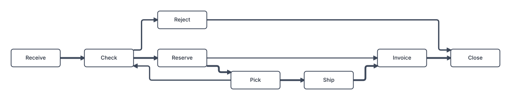

**process map: top to bottom, orthogonal**

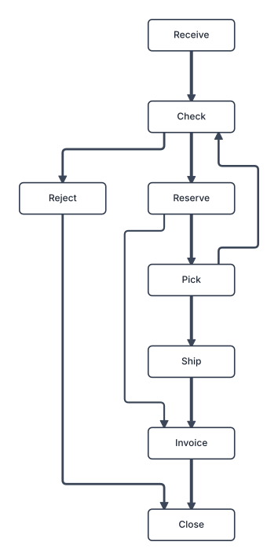

**process map, diagonal routing**

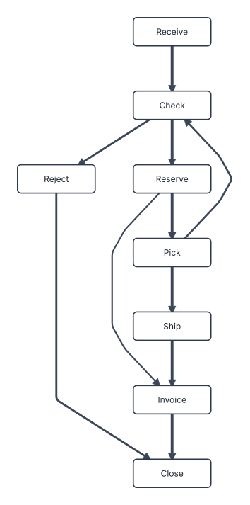

**process map, left to right**

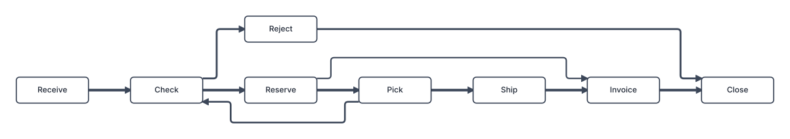

**hub and spoke**

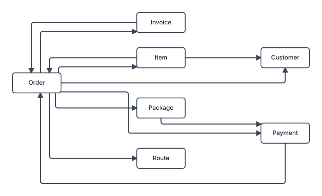

**hub and spoke with a flow**

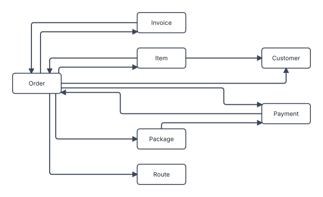

<details><summary>Code (<code>tests/gallery/presets.rs</code>)</summary>

```rust
use graphlay::{layout, Direction, Edge, GraphBuilder, LayoutOptions, Node, RoutingStyle, Size};

use super::Panel;

/// An order process with a rework loop and a skip, with edge weights from case counts.
fn order_process() -> graphlay::Graph {
    let mut b = GraphBuilder::new();
    let mut step = |name: &str| {
        b.add_node(Node {
            size: Size::new(110.0, 40.0),
            key: Some(name.to_string()),
            ..Node::default()
        })
    };
    let (receive, check, reserve, pick, ship, invoice, close, reject) = (
        step("Receive"),
        step("Check"),
        step("Reserve"),
        step("Pick"),
        step("Ship"),
        step("Invoice"),
        step("Close"),
        step("Reject"),
    );
    for (s, t, count) in [
        (receive, check, 400.0),
        (check, reserve, 360.0),
        (check, reject, 40.0),
        (reserve, pick, 360.0),
        (pick, ship, 350.0),
        (ship, invoice, 350.0),
        (invoice, close, 350.0),
        (reject, close, 40.0),
        (reserve, invoice, 10.0),
        (pick, check, 25.0),
    ] {
        let mut e = Edge::new(s, t);
        e.weight = 1.0 + f64::ln(count);
        e.thickness = (1.0 + f64::ln(count) / 2.0).min(5.0);
        b.add_edge(e);
    }
    b.build()
}

/// Four object types around one central type, as a data model's type graph looks.
fn type_graph() -> graphlay::Graph {
    let mut b = GraphBuilder::new();
    let mut kind = |name: &str| {
        b.add_node(Node {
            size: Size::new(96.0, 40.0),
            key: Some(name.to_string()),
            ..Node::default()
        })
    };
    let order = kind("Order");
    let others: Vec<_> = ["Item", "Customer", "Invoice", "Package", "Payment", "Route"]
        .into_iter()
        .map(&mut kind)
        .collect();
    for (i, &other) in others.iter().enumerate() {
        b.connect(order, other);
        if i % 2 == 0 {
            b.connect(other, order);
        }
        if i + 1 < others.len() && i % 3 == 0 {
            b.connect(other, others[i + 1]);
        }
    }
    b.build()
}

pub fn panels() -> Vec<Panel> {
    let mut out = Vec::new();
    let process = order_process();
    let mut draw = |caption: &str, options: LayoutOptions| {
        let drawing = layout(&process, &options).expect("lays out");
        out.push(Panel::new(caption, process.clone(), &options, drawing));
    };
    draw(
        "layered, left to right: the default",
        LayoutOptions::layered_default(),
    );
    draw(
        "process map: top to bottom, orthogonal",
        LayoutOptions::process_map(),
    );
    let mut diagonal = LayoutOptions::process_map();
    diagonal.routing.style = RoutingStyle::Diagonal;
    draw("process map, diagonal routing", diagonal);
    let mut across = LayoutOptions::process_map();
    across.direction = Direction::LeftRight;
    draw("process map, left to right", across);

    let types = type_graph();
    for (caption, options) in [
        ("hub and spoke", LayoutOptions::hub_and_spoke()),
        (
            "hub and spoke with a flow",
            LayoutOptions::hub_and_spoke_flow(),
        ),
    ] {
        let drawing = layout(&types, &options).expect("lays out");
        out.push(Panel::new(caption, types.clone(), &options, drawing));
    }
    out
}
```

</details>

## Merged edges

`Routing::merge_edges` draws the edges leaving a node (forks) and the edges reaching a node (joins) on one shared trunk that branches off a common riser. `Layout::junctions` lists the branch points, drawn here as dots. A merge is kept only where it adds no crossing, no bend and no node hit, and an arriving edge never shares a trunk with a leaving one.

**merge_edges: None (default)**

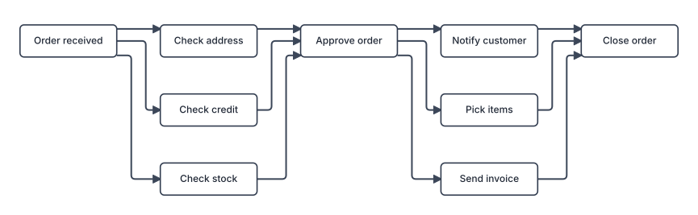

**merge_edges: Both**


<details><summary>Code (<code>tests/gallery/merge_edges.rs</code>)</summary>

```rust
use graphlay::{layout, GraphBuilder, LayoutOptions, MergeEdges, Node, Size};

use super::Panel;

pub fn panels() -> Vec<Panel> {
    let mut b = GraphBuilder::new();
    let names = [
        "Order received",
        "Check stock",
        "Check credit",
        "Check address",
        "Approve order",
        "Pick items",
        "Send invoice",
        "Notify customer",
        "Close order",
    ];
    let n: Vec<_> = names
        .iter()
        .map(|name| {
            b.add_node(Node {
                size: Size::new(120.0, 40.0),
                key: Some(name.to_string()),
                ..Node::default()
            })
        })
        .collect();
    for (s, t) in [(0, 1), (0, 2), (0, 3), (1, 4), (2, 4), (3, 4)] {
        b.connect(n[s], n[t]);
    }
    for (s, t) in [(4, 5), (4, 6), (4, 7), (5, 8), (6, 8), (7, 8)] {
        b.connect(n[s], n[t]);
    }
    let graph = b.build();

    let mut options = LayoutOptions::default();
    let plain = options;
    let separate = layout(&graph, &plain).expect("lays out");
    options.routing.merge_edges = MergeEdges::Both;
    let merged = layout(&graph, &options).expect("lays out");
    vec![
        Panel::new(
            "merge_edges: None (default)",
            graph.clone(),
            &plain,
            separate,
        ),
        Panel::new("merge_edges: Both", graph, &options, merged),
    ]
}
```

</details>

## Port hints

`Edge::source_port` and `Edge::target_port` choose the border an edge leaves or enters (`PortHint::Side`), or an exact point along it (`PortHint::Offset`). Here the rework loop from Approve back to Assess claim leaves and enters at the bottom, so it runs underneath the main line. Both loops are marked `reverse_for_ranking`, which tells the layering they run against the flow, so the main line reads left to right.

**no hints**

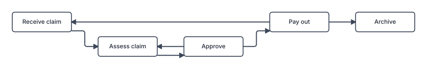

**rework loop: Bottom -> Bottom**


<details><summary>Code (<code>tests/gallery/port_hints.rs</code>)</summary>

```rust
use graphlay::{layout, Edge, GraphBuilder, LayoutOptions, Node, PortHint, Side, Size};

use super::Panel;

pub fn panels() -> Vec<Panel> {
    let build = |hinted: bool| {
        let mut b = GraphBuilder::new();
        let n: Vec<_> = [
            "Receive claim",
            "Assess claim",
            "Approve",
            "Pay out",
            "Archive",
        ]
        .iter()
        .map(|name| {
            b.add_node(Node {
                size: Size::new(120.0, 40.0),
                key: Some(name.to_string()),
                ..Node::default()
            })
        })
        .collect();
        for (s, t) in [(0, 1), (1, 2), (2, 3), (3, 4)] {
            b.connect(n[s], n[t]);
        }
        // Send back for review: Approve -> Assess claim, underneath.
        let bottom = hinted.then_some(PortHint::Side(Side::Bottom));
        b.add_edge(Edge {
            source_port: bottom,
            target_port: bottom,
            reverse_for_ranking: true,
            ..Edge::new(n[2], n[1])
        });
        // Reopen: Pay out -> Receive claim.
        b.add_edge(Edge {
            reverse_for_ranking: true,
            ..Edge::new(n[3], n[0])
        });
        b.build()
    };
    let options = LayoutOptions::default();
    let (plain, hinted) = (build(false), build(true));
    let (a, b) = (
        layout(&plain, &options).expect("lays out"),
        layout(&hinted, &options).expect("lays out"),
    );
    vec![
        Panel::new("no hints", plain, &options, a),
        Panel::new("rework loop: Bottom -> Bottom", hinted, &options, b),
    ]
}
```

</details>

## Swimlanes

`Node::group` puts nodes into lanes. With `GroupLanes::Soft` (the default) groups become bands only where that is cheap. With `GroupLanes::Strict` every group gets a strip of its own, whatever it costs, and `Layout::lanes` returns the strips as rectangles that tile the drawing. `Node::lane_key` orders the nodes inside a lane.

**group_lanes: Soft (default)**

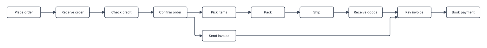

**group_lanes: Strict**


<details><summary>Code (<code>tests/gallery/swimlanes.rs</code>)</summary>

```rust
use graphlay::{layout, GraphBuilder, GroupId, GroupLanes, LayoutOptions, Node, Size};

use super::Panel;

/// Lane names, by group id.
pub const LANES: &[&str] = &["Customer", "Sales", "Warehouse", "Finance"];

pub fn panels() -> Vec<Panel> {
    let mut b = GraphBuilder::new();
    let steps = [
        ("Place order", 0),
        ("Receive order", 1),
        ("Check credit", 3),
        ("Confirm order", 1),
        ("Pick items", 2),
        ("Pack", 2),
        ("Ship", 2),
        ("Send invoice", 3),
        ("Receive goods", 0),
        ("Pay invoice", 0),
        ("Book payment", 3),
    ];
    let n: Vec<_> = steps
        .iter()
        .map(|&(name, lane)| {
            b.add_node(Node {
                size: Size::new(120.0, 40.0),
                key: Some(name.to_string()),
                group: Some(GroupId(lane)),
                ..Node::default()
            })
        })
        .collect();
    for (s, t) in [
        (0, 1),
        (1, 2),
        (2, 3),
        (3, 4),
        (4, 5),
        (5, 6),
        (3, 7),
        (6, 8),
        (7, 9),
        (8, 9),
        (9, 10),
    ] {
        b.connect(n[s], n[t]);
    }
    let graph = b.build();

    let mut options = LayoutOptions::default();
    let plain = options;
    let soft = layout(&graph, &plain).expect("lays out");
    options.order.group_lanes = GroupLanes::Strict;
    let strict = layout(&graph, &options).expect("lays out");
    vec![
        Panel::new("group_lanes: Soft (default)", graph.clone(), &plain, soft),
        Panel::new("group_lanes: Strict", graph, &options, strict).with_lanes(LANES),
    ]
}
```

</details>

## Nested subprocesses

A node whose `Node::parent` is set is drawn inside that parent, which becomes a box around its children. Compounds nest to any depth and are laid out bottom-up. An edge that crosses a compound's border is cut there and joined again exactly on the border. `Spacing::compound_header` leaves room for a title.

**Direction::LeftRight**


**Direction::TopBottom**

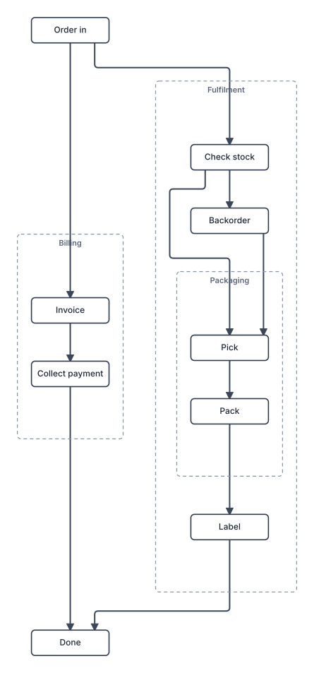

<details><summary>Code (<code>tests/gallery/compounds.rs</code>)</summary>

```rust
use graphlay::{layout, Direction, GraphBuilder, LayoutOptions, Node, NodeId, Size};

use super::Panel;

pub fn panels() -> Vec<Panel> {
    let mut b = GraphBuilder::new();
    let mut node = |name: &str, parent: Option<NodeId>| {
        b.add_node(Node {
            size: Size::new(110.0, 36.0),
            key: Some(name.to_string()),
            parent,
            ..Node::default()
        })
    };
    let order_in = node("Order in", None);
    let fulfilment = node("Fulfilment", None);
    let check = node("Check stock", Some(fulfilment));
    let backorder = node("Backorder", Some(fulfilment));
    let packaging = node("Packaging", Some(fulfilment));
    let pick = node("Pick", Some(packaging));
    let pack = node("Pack", Some(packaging));
    let label = node("Label", Some(fulfilment));
    let billing = node("Billing", None);
    let invoice = node("Invoice", Some(billing));
    let collect = node("Collect payment", Some(billing));
    let done = node("Done", None);
    for (s, t) in [
        (order_in, check),
        (check, pick),
        (check, backorder),
        (backorder, pick),
        (pick, pack),
        (pack, label),
        (label, done),
        (order_in, invoice),
        (invoice, collect),
        (collect, done),
    ] {
        b.connect(s, t);
    }
    let graph = b.build();

    let mut options = LayoutOptions::default();
    options.spacing.compound_header = 16.0;
    let across_options = options;
    let across = layout(&graph, &across_options).expect("lays out");
    options.direction = Direction::TopBottom;
    let down = layout(&graph, &options).expect("lays out");
    vec![
        Panel::new(
            "Direction::LeftRight",
            graph.clone(),
            &across_options,
            across,
        ),
        Panel::new("Direction::TopBottom", graph, &options, down),
    ]
}
```

</details>

## Wrapping into rows

A long process is much wider than a screen. `WrapOptions::viewport_aspect` breaks the drawing into rows for a viewport of that width-to-height ratio, cutting where the fewest edges cross.

**wrap.viewport_aspect = 16 / 9**


<details><summary>Code (<code>tests/gallery/wrapping.rs</code>)</summary>

```rust
use graphlay::{layout, GraphBuilder, LayoutOptions, Node, Size};

use super::Panel;

pub fn panels() -> Vec<Panel> {
    let mut b = GraphBuilder::new();
    let steps = [
        "Lead",
        "Qualify",
        "Demo",
        "Offer",
        "Negotiate",
        "Contract",
        "Onboard",
        "Kick-off",
        "Deliver",
        "Invoice",
        "Renew",
    ];
    let n: Vec<_> = steps
        .iter()
        .map(|name| {
            b.add_node(Node {
                size: Size::new(100.0, 36.0),
                key: Some(name.to_string()),
                ..Node::default()
            })
        })
        .collect();
    for w in n.windows(2) {
        b.connect(w[0], w[1]);
    }
    // Two shortcuts and a loop back.
    b.connect(n[1], n[5]);
    b.connect(n[4], n[3]);
    b.connect(n[8], n[10]);
    let graph = b.build();

    let mut options = LayoutOptions::default();
    options.wrap.viewport_aspect = 16.0 / 9.0;
    let wrapped = layout(&graph, &options).expect("lays out");
    vec![Panel::new(
        "wrap.viewport_aspect = 16 / 9",
        graph,
        &options,
        wrapped,
    )]
}
```

</details>

## A tidy tree

`tree::layout` draws a rooted tree or forest with every parent centred over its children, in the Reingold-Tilford style. Its options are `TreeOptions`, which set the gaps between siblings and subtrees, the direction, and whether an edge runs straight to the child or as an elbow through a shared trunk.

**elbow edges, top to bottom**

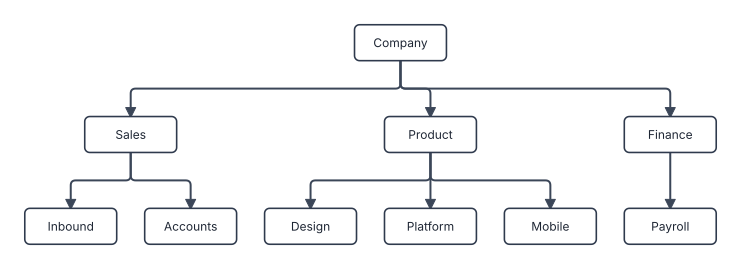

**straight edges**

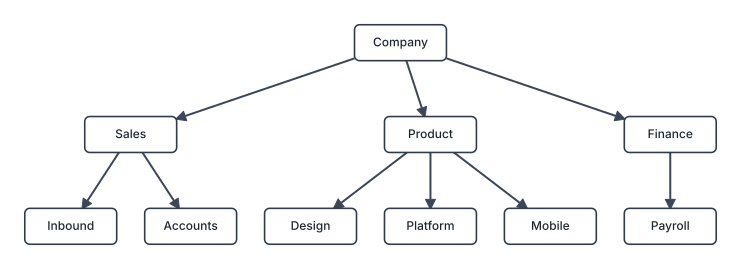

**left to right**

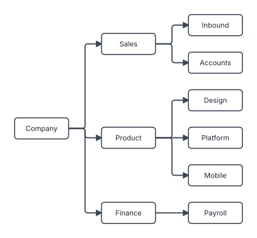

<details><summary>Code (<code>tests/gallery/tree.rs</code>)</summary>

```rust
use graphlay::tree::{self, TreeEdgeStyle, TreeOptions};
use graphlay::{Direction, GraphBuilder, LayoutOptions, Node, Size};

use super::Panel;

pub fn panels() -> Vec<Panel> {
    let mut b = GraphBuilder::new();
    let mut unit = |name: &str| {
        b.add_node(Node {
            size: Size::new(92.0, 36.0),
            key: Some(name.to_string()),
            ..Node::default()
        })
    };
    let company = unit("Company");
    let (sales, product, finance) = (unit("Sales"), unit("Product"), unit("Finance"));
    let teams = [
        (sales, "Inbound"),
        (sales, "Accounts"),
        (product, "Design"),
        (product, "Platform"),
        (product, "Mobile"),
        (finance, "Payroll"),
    ];
    let teams: Vec<_> = teams
        .into_iter()
        .map(|(parent, name)| (parent, unit(name)))
        .collect();
    for (parent, team) in teams {
        b.connect(parent, team);
    }
    for child in [sales, product, finance] {
        b.connect(company, child);
    }
    let graph = b.build();

    let elbow = TreeOptions {
        direction: Direction::TopBottom,
        edge_style: TreeEdgeStyle::Elbow,
        ..TreeOptions::default()
    };
    let straight = TreeOptions {
        edge_style: TreeEdgeStyle::Straight,
        ..elbow
    };
    let sideways = TreeOptions {
        direction: Direction::LeftRight,
        ..elbow
    };
    // The metrics check takes layered options. A tree has none, so the default stands in.
    let measured = LayoutOptions::layered_default();
    [
        ("elbow edges, top to bottom", elbow),
        ("straight edges", straight),
        ("left to right", sideways),
    ]
    .into_iter()
    .map(|(caption, options)| {
        let drawing = tree::layout(&graph, &options).expect("lays out");
        Panel::new(caption, graph.clone(), &measured, drawing)
    })
    .collect()
}
```

</details>

## Drawing styles

A layout is positions and polylines, and the renderer decides how they look. Every page of this gallery draws with `svg::sketch`, the plain look, and `sketch_scene` hands the same drawing over as a `Scene` to restyle: shapes, fills, token rows, icons, rings, edge colours and widths, gradients, bands, markers, labels, a legend, and a palette for whatever names no colour.

**a Petri net**

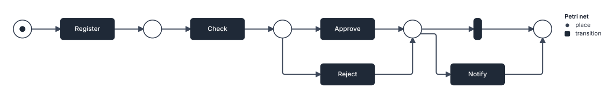

**the happy path**

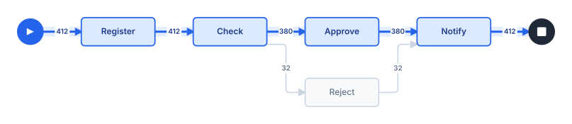

**frequencies as heat**


**a finite automaton**


**a service map**


<details><summary>Code (<code>tests/gallery/styles.rs</code>)</summary>

```rust
use std::path::Path;

use graphlay::svg::{
    self, sketch_scene, BuiltinMarker, Chip, Decoration, EdgeLabel, GlyphRow, Gradient,
    GradientStop, LegendItem, LineCap, MarkerRef, NodeContent, Overlay, Paint, Palette, Point,
    Ring, SketchOptions, Stroke, Swatch, TextRun, SYMBOL_PLAY_TRIANGLE, SYMBOL_STOP_SQUARE,
    SYMBOL_SWATCH_DOT,
};
use graphlay::{
    fixture, layout, Direction, Edge, Graph, GraphBuilder, Layout, LayoutOptions, LoopSide, Node,
    Shape, Size,
};

use super::Panel;

const BLUE: &str = "#2563eb";
const INK: &str = "#1f2937";

/// `text` on a chip, at the spot the layout reserved for edge `i`'s label.
fn chip(drawing: &Layout, i: usize, text: impl Into<String>, colour: &str) -> EdgeLabel {
    let text = TextRun::new(text).size(10.0).weight(600.0).color(colour);
    EdgeLabel::new(text, drawing.edges[i].label_anchor).chip()
}

/// A legend just right of the drawing.
fn legend(drawing: &Layout, title: &str, items: impl IntoIterator<Item = LegendItem>) -> Overlay {
    let origin = Point::new(drawing.bounds.max.x + 24.0, drawing.bounds.min.y);
    Overlay::panel(svg::Panel::legend(origin, title, items))
}

/// Edge `i` runs along `main` when it joins two of its nodes in order.
fn on_path(g: &Graph, i: usize, main: &[usize]) -> bool {
    let e = &g.edges[i];
    main.windows(2)
        .any(|w| e.source.index() == w[0] && e.target.index() == w[1])
}

/// A Petri net: places and transitions alternate, and the first place holds the token.
fn petri_net() -> Panel {
    let mut b = GraphBuilder::new();
    let mut place = |name: &str| {
        b.add_node(Node {
            size: Size::new(34.0, 34.0),
            shape: Shape::Ellipse,
            key: Some(name.to_string()),
            ..Node::default()
        })
    };
    let (p0, p1, p2, p3, p4) = (
        place("p0"),
        place("p1"),
        place("p2"),
        place("p3"),
        place("p4"),
    );
    let mut transition = |name: &str, width: f64| {
        b.add_node(Node {
            size: Size::new(width, 40.0),
            key: Some(name.to_string()),
            ..Node::default()
        })
    };
    let register = transition("Register", 100.0);
    let check = transition("Check", 100.0);
    let approve = transition("Approve", 100.0);
    let reject = transition("Reject", 100.0);
    let skip = transition("", 14.0);
    let notify = transition("Notify", 100.0);
    for (s, t) in [
        (p0, register),
        (register, p1),
        (p1, check),
        (check, p2),
        (p2, approve),
        (p2, reject),
        (approve, p3),
        (reject, p3),
        (p3, skip),
        (p3, notify),
        (skip, p4),
        (notify, p4),
    ] {
        b.connect(s, t);
    }
    let net = b.build();
    let options = LayoutOptions::layered_default();
    let drawing = layout(&net, &options).expect("lays out");

    let mut scene = sketch_scene(&net, &drawing, &SketchOptions::default());
    for (i, node) in scene.nodes.iter_mut().enumerate() {
        if net.nodes[i].shape == Shape::Ellipse {
            node.shape = svg::Shape::Circle;
            node.content.clear();
            if i == 0 {
                node.content
                    .push(NodeContent::Glyphs(GlyphRow::dots(1, 5.5, INK)));
            }
        } else {
            node.fill = Some(INK.to_string());
            node.stroke = Some(Stroke::new(INK, 1.6));
            if let Some(text) = node.label_mut() {
                text.color = Some("#ffffff".to_string());
            }
        }
    }
    let place = Swatch::Symbol {
        id: SYMBOL_SWATCH_DOT.to_string(),
        size: svg::Size::new(10.0, 10.0),
        color: None,
    };
    let items = [
        LegendItem::new(place, "place"),
        LegendItem::new(Swatch::color(INK), "transition"),
    ];
    scene.overlays.push(legend(&drawing, "Petri net", items));
    Panel::new("a Petri net", net, &options, drawing).scene(scene, Palette::default())
}

/// An approval process between a start and an end event, with case counts on the edges.
fn happy_path() -> Panel {
    let mut b = GraphBuilder::new();
    let mut event = |name: &str| {
        b.add_node(Node {
            size: Size::new(36.0, 36.0),
            shape: Shape::Ellipse,
            key: Some(name.to_string()),
            ..Node::default()
        })
    };
    let (start, end) = (event("start"), event("end"));
    let mut task = |name: &str| {
        b.add_node(Node {
            size: Size::new(104.0, 40.0),
            key: Some(name.to_string()),
            ..Node::default()
        })
    };
    let (register, check, approve, reject, notify) = (
        task("Register"),
        task("Check"),
        task("Approve"),
        task("Reject"),
        task("Notify"),
    );
    let steps = [
        (start, register, 412),
        (register, check, 412),
        (check, approve, 380),
        (check, reject, 32),
        (approve, notify, 380),
        (reject, notify, 32),
        (notify, end, 412),
    ];
    for (s, t, _) in steps {
        let mut e = Edge::new(s, t);
        e.label_size = Some(Size::new(26.0, 14.0));
        b.add_edge(e);
    }
    let g = b.build();
    let options = LayoutOptions::layered_default();
    let drawing = layout(&g, &options).expect("lays out");
    let main = [0usize, 2, 3, 4, 6, 1];

    let mut scene = sketch_scene(&g, &drawing, &SketchOptions::default());
    for (i, node) in scene.nodes.iter_mut().enumerate() {
        if g.nodes[i].shape == Shape::Ellipse {
            let (colour, icon, size) = if i == start.index() {
                (BLUE, SYMBOL_PLAY_TRIANGLE, svg::Size::new(10.0, 11.6))
            } else {
                (INK, SYMBOL_STOP_SQUARE, svg::Size::new(12.6, 12.6))
            };
            node.shape = svg::Shape::Circle;
            node.fill = Some(colour.to_string());
            node.stroke = Some(Stroke::new(colour, 1.6));
            node.content = vec![NodeContent::symbol(icon, size, "#ffffff")];
        } else if main.contains(&i) {
            node.fill = Some("#dbeafe".to_string());
            node.stroke = Some(Stroke::new(BLUE, 1.75));
            if let Some(text) = node.label_mut() {
                text.color = Some("#1e3a8a".to_string());
                text.weight = Some(600.0);
            }
        } else {
            node.fill = Some("#f8fafc".to_string());
            node.stroke = Some(Stroke::new("#cbd5e1", 1.6));
            if let Some(text) = node.label_mut() {
                text.color = Some("#64748b".to_string());
            }
        }
    }
    for (i, edge) in scene.edges.iter_mut().enumerate() {
        let on = on_path(&g, i, &main);
        edge.stroke = Stroke::new(
            if on { BLUE } else { "#cbd5e1" },
            if on { 3.0 } else { 1.6 },
        );
        if on {
            // A soft band under the path draws it as one stroke of colour.
            let band = Stroke {
                linecap: LineCap::Round,
                opacity: Some(0.45),
                ..Stroke::new("#bfdbfe", 14.0)
            };
            edge.decorations.push(Decoration::band(edge, band));
        }
        let text = if on { "#1e3a8a" } else { "#64748b" };
        edge.labels
            .push(chip(&drawing, i, steps[i].2.to_string(), text));
    }
    Panel::new("the happy path", g, &options, drawing).scene(scene, Palette::default())
}

/// A directly-follows graph of a repair process, with the case count of each step and each
/// activity shown as colour: the busier, the deeper the blue.
fn heat_map() -> Panel {
    let path =
        Path::new(env!("CARGO_MANIFEST_DIR")).join("fixtures/dfg/dfg-repairexample-all.json");
    let f = fixture::load_file(&path).expect("the fixture loads");
    let (mut g, mut options) = f.to_graph();
    options.spacing.layer_gap = 84.0;
    for (i, n) in g.nodes.iter_mut().enumerate() {
        if f.nodes[i].label.is_empty() {
            n.size = Size::new(22.0, 22.0);
        }
    }
    for e in &mut g.edges {
        e.label_size = Some(Size::new(34.0, 14.0));
    }
    let drawing = layout(&g, &options).expect("lays out");
    // The fixture stores `1 + ln(count)` as the weight.
    let count = |i: usize| (f.edges[i].weight - 1.0).exp().round() as u64;
    let mut through = vec![0u64; g.nodes.len()];
    for (i, e) in g.edges.iter().enumerate() {
        through[e.target.index()] += count(i);
    }
    let busiest = through.iter().copied().max().unwrap_or(1).max(1);
    let most = (0..g.edges.len()).map(count).max().unwrap_or(1).max(1) as f64;

    // Fill and text colour, from the quietest activity to the busiest.
    const HEAT: [(&str, &str); 6] = [
        ("#eff6ff", "#1e3a8a"),
        ("#dbeafe", "#1e3a8a"),
        ("#bfdbfe", "#1e3a8a"),
        ("#93c5fd", "#1e3a8a"),
        ("#3b82f6", "#ffffff"),
        ("#1d4ed8", "#ffffff"),
    ];
    let labels = f.nodes.iter().map(|n| n.label.clone()).collect();
    let sketch = SketchOptions {
        labels,
        ..SketchOptions::default()
    };
    let mut scene = sketch_scene(&g, &drawing, &sketch);
    for (i, node) in scene.nodes.iter_mut().enumerate() {
        if f.nodes[i].label.is_empty() {
            // The start and end markers of the log.
            node.shape = svg::Shape::Circle;
            node.fill = Some(INK.to_string());
            node.stroke = Some(Stroke::new(INK, 1.6));
            continue;
        }
        let bin = ((through[i] as f64 / busiest as f64) * 5.0).round() as usize;
        let (fill, text) = HEAT[bin.min(5)];
        node.fill = Some(fill.to_string());
        node.stroke = Some(Stroke::new("#1e40af", 1.25));
        if let Some(label) = node.label_mut() {
            label.color = Some(text.to_string());
            label.weight = Some(600.0);
        }
    }
    for (i, edge) in scene.edges.iter_mut().enumerate() {
        let c = count(i);
        let share = (c as f64).ln().max(0.0) / most.ln();
        let colour = if share > 0.66 {
            "#1e3a8a"
        } else if share > 0.33 {
            "#475569"
        } else {
            "#94a3b8"
        };
        edge.stroke = Stroke::new(colour, 1.2 + 3.3 * share);
        edge.labels.push(chip(&drawing, i, c.to_string(), colour));
    }
    let shades = [(5, "every case"), (3, "most cases"), (0, "a few")]
        .map(|(bin, text)| LegendItem::new(Swatch::color(HEAT[bin].0), text));
    scene.overlays.push(legend(&drawing, "Cases", shades));
    Panel::new("frequencies as heat", g, &options, drawing).scene(scene, Palette::default())
}

/// A finite automaton: circles for states, a double ring for the accepting ones, self-loops
/// for the transitions that stay, and the symbol read on every edge.
fn automaton() -> Panel {
    let mut b = GraphBuilder::new();
    let mut state = |name: &str| {
        b.add_node(Node {
            size: Size::new(44.0, 44.0),
            shape: Shape::Ellipse,
            key: Some(name.to_string()),
            ..Node::default()
        })
    };
    let q: Vec<_> = (0..5).map(|i| state(&format!("q{i}"))).collect();
    // The arrow into the initial state comes from a point-sized node nothing draws.
    let start = b.add_node(Node {
        size: Size::new(2.0, 2.0),
        ..Node::default()
    });
    let transitions = [
        (start, q[0], ""),
        (q[0], q[1], "a"),
        (q[0], q[0], "b"),
        (q[1], q[1], "a"),
        (q[1], q[2], "b"),
        (q[2], q[3], "a"),
        (q[2], q[0], "b"),
        (q[3], q[4], "b"),
        (q[3], q[3], "a"),
        (q[4], q[4], "a, b"),
    ];
    for (s, t, symbol) in transitions {
        let mut e = Edge::new(s, t);
        if !symbol.is_empty() {
            e.label_size = Some(Size::new(8.0 * symbol.len() as f64 + 8.0, 14.0));
        }
        b.add_edge(e);
    }
    let g = b.build();
    let mut options = LayoutOptions::layered_default();
    options.self_loops.side = LoopSide::CrossNegative;
    let drawing = layout(&g, &options).expect("lays out");
    let accepting = [q[2].index(), q[4].index()];

    let mut scene = sketch_scene(&g, &drawing, &SketchOptions::default());
    for (i, node) in scene.nodes.iter_mut().enumerate() {
        if i == start.index() {
            node.fill = Some("none".to_string());
            node.stroke = Some(Stroke::new("none", 1.6));
            continue;
        }
        node.shape = svg::Shape::Circle;
        node.stroke = Some(Stroke::new(INK, 1.75));
        if accepting.contains(&i) {
            let ring = Ring {
                color: INK.to_string(),
                width: 1.5,
                inset: 4.0,
            };
            node.content.push(NodeContent::Rings { rings: vec![ring] });
        }
    }
    for (i, edge) in scene.edges.iter_mut().enumerate() {
        edge.stroke = Stroke::new(INK, 1.6);
        let symbol = transitions[i].2;
        if !symbol.is_empty() {
            edge.labels.push(chip(&drawing, i, symbol, INK));
        }
    }
    Panel::new("a finite automaton", g, &options, drawing).scene(scene, Palette::default())
}

/// A service map on a dark background: clients, services and stores in their own colours,
/// edge width by request rate, a gradient where a call crosses tiers, and latency chips.
fn service_map() -> Panel {
    const TIER: [&str; 3] = ["#38bdf8", "#a78bfa", "#34d399"];
    let services = [
        ("Web app", 0),
        ("Mobile API", 0),
        ("Auth", 1),
        ("Orders", 1),
        ("Catalog", 1),
        ("Payments", 1),
        ("Notify", 1),
        ("Users DB", 2),
        ("Orders DB", 2),
        ("Cache", 2),
        ("Queue", 2),
    ];
    let mut b = GraphBuilder::new();
    let ids: Vec<_> = services
        .iter()
        .map(|(name, tier)| {
            b.add_node(Node {
                size: Size::new(if *tier == 2 { 96.0 } else { 104.0 }, 40.0),
                shape: if *tier == 2 {
                    Shape::Ellipse
                } else {
                    Shape::Box
                },
                key: Some(name.to_string()),
                ..Node::default()
            })
        })
        .collect();
    let calls = [
        (0, 2, 120.0, "8 ms"),
        (0, 3, 300.0, "24 ms"),
        (0, 4, 900.0, "5 ms"),
        (1, 2, 200.0, "9 ms"),
        (1, 3, 150.0, "26 ms"),
        (3, 5, 140.0, "41 ms"),
        (3, 4, 300.0, "4 ms"),
        (3, 6, 100.0, "2 ms"),
        (5, 6, 90.0, "3 ms"),
        (2, 7, 320.0, "1 ms"),
        (3, 8, 450.0, "3 ms"),
        (4, 9, 1200.0, "<1 ms"),
        (4, 8, 60.0, "6 ms"),
        (6, 10, 190.0, "1 ms"),
        (5, 8, 140.0, "2 ms"),
    ];
    for (s, t, _, _) in calls {
        let mut e = Edge::new(ids[s], ids[t]);
        e.label_size = Some(Size::new(38.0, 14.0));
        b.add_edge(e);
    }
    let g = b.build();
    let mut options = LayoutOptions::layered_default();
    options.direction = Direction::LeftRight;
    options.spacing.layer_gap = 120.0;
    options.spacing.node_gap = 40.0;
    let drawing = layout(&g, &options).expect("lays out");

    let mut scene = sketch_scene(&g, &drawing, &SketchOptions::default());
    for (i, node) in scene.nodes.iter_mut().enumerate() {
        node.fill = Some("#1e293b".to_string());
        node.stroke = Some(Stroke::new(TIER[services[i].1], 1.75));
        if let Some(text) = node.label_mut() {
            text.color = Some("#e2e8f0".to_string());
            text.weight = Some(600.0);
        }
    }
    for (i, edge) in scene.edges.iter_mut().enumerate() {
        let (s, t, rate, latency): (usize, usize, f64, &str) = calls[i];
        let (from, to) = (TIER[services[s].1], TIER[services[t].1]);
        edge.stroke = Stroke::new(from, 1.2 + 2.6 * rate.ln() / 1200f64.ln());
        if from != to {
            let stop = |offset, colour: &str| GradientStop {
                offset,
                color: colour.to_string(),
            };
            edge.stroke.paint = Paint::Gradient(Gradient {
                from: edge.points[0],
                to: edge.points[edge.points.len() - 1],
                stops: vec![stop(0.0, from), stop(1.0, to)],
            });
            edge.marker_end = MarkerRef::builtin(BuiltinMarker::Arrow).colored(to);
        }
        edge.labels.push(EdgeLabel {
            chip: Some(Chip {
                fill: "#0f172a".to_string(),
                ..Chip::default()
            }),
            ..chip(&drawing, i, latency, "#cbd5e1")
        });
    }
    let tiers = ["clients", "services", "stores"]
        .into_iter()
        .zip(TIER)
        .map(|(text, colour)| LegendItem::new(Swatch::color(colour), text));
    scene.overlays.push(legend(&drawing, "Tiers", tiers));
    scene.background = Some("#0b1220".to_string());
    // The legend's text takes the palette's text colour.
    let palette = Palette {
        node_text: "#e2e8f0".to_string(),
        ..Palette::default()
    };
    Panel::new("a service map", g, &options, drawing).scene(scene, palette)
}

pub fn panels() -> Vec<Panel> {
    vec![
        petri_net(),
        happy_path(),
        heat_map(),
        automaton(),
        service_map(),
    ]
}
```

</details>

